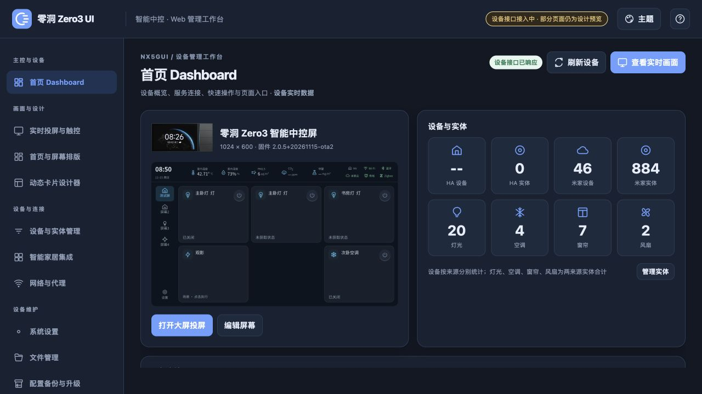
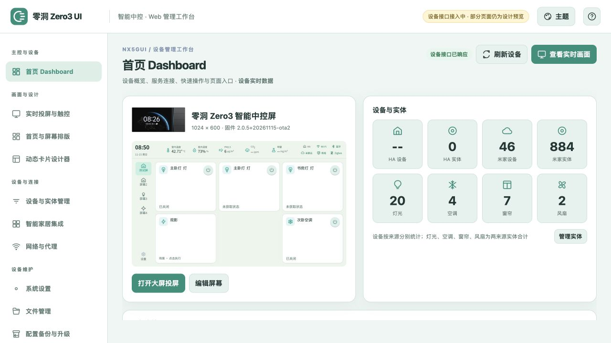
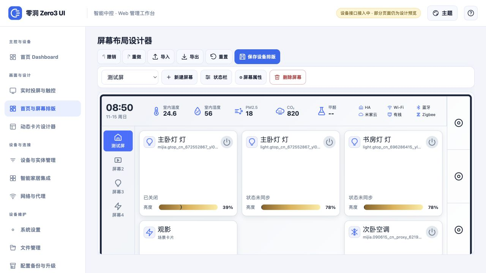
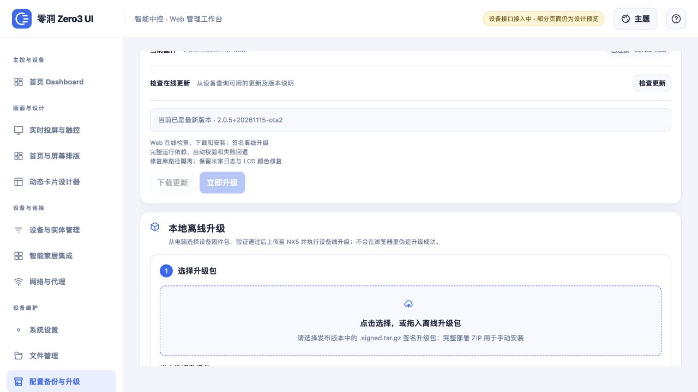

# 零洞 Zero3 UI · 2.0

适用于 **NX5 / Zero3 · 1024 × 600 触屏面板**。基于 LVGL 9.6 与 Linux，将 Home Assistant、米家、可编排桌面、场景和 Web 管理整合到一块屏幕中，日常运行无需连接电脑。

当前正式版 **2.0.5+20261115-ota2** · 文档更新于 **2026-11-15**。

[下载正式版](https://github.com/snailll2/zero3-firmware/releases/tag/v2.0.5-20261115) · [2.0 使用手册](USAGE.md) · [版本与升级验证](https://github.com/snailll2/zero3-firmware/blob/main/docs/releases/2.0.5.md)

## 2.0 能做什么

| 功能 | 说明 |
| --- | --- |
| 多屏桌面 | 独立屏幕名称、图标与网格，拖放卡片到指定位置；保存后应用到设备。 |
| 实体卡片 | 灯光、开关、空调、窗帘、风扇及传感器等；按实体能力显示电源、滑条、模式与详情控件。 |
| 场景执行 | 场景卡片可配置多步骤动作与延迟；也可绑定 HA 的场景、脚本或按钮实体。 |
| 四种主题 | 浅色、深色、暖色、薄荷，适配桌面、状态栏、设置与控件颜色；Web 顶部可直接预览选择。 |
| Home Assistant | 服务器与令牌配置、实体发现、状态同步及控制，设备列表可筛选并查看属性。 |
| 米家 | 小米账号授权、设备发现、MIoT 规则转换、云端与本地中枢控制；通道可用性取决于设备能力及授权。 |
| BLE / Zigbee 代理 | BLE 广播经 MQTT 转发至 HA；Zigbee 串口桥供 HA 侧 ZHA / Zigbee2MQTT 使用。 |
| 远程操作 | Web 实时投屏与触控、屏幕排版、接入与网络配置、文件管理、配置备份及黑匣子诊断。 |
| 网络与待机 | Wi-Fi 扫描和连接进度、有线网络配置、亮度、息屏、屏保与触摸唤醒。 |
| 完整升级 | 设备端更新入口、Web 在线升级及签名离线升级；显示下载、校验、安装、重启和启动检查进度。 |

卡片控件由实体实际能力决定；未同步或离线时显示对应提示。摄像头支持配置 RTSP / HA 源，兼容性与流畅度取决于视频编码和设备资源。

## 少量页面，看看实际效果

以下为 **2.0.5 实机 Web 新截图**。四主题截图中嵌入的画面来自设备实时投屏；排版设计器是浏览器预览，示例读数与样式不等于设备当前状态。数量、名称与连接状态仅为拍摄现场样本。

图片以两列缩略图展示，点击可查看原图。

<table>
<tr><th>浅色</th><th>深色</th></tr>
<tr><td><a href="docs/screenshots/2.0.5/web-light.jpg"></a></td><td><a href="docs/screenshots/2.0.5/web-dark.jpg"></a></td></tr>
<tr><th>暖色</th><th>薄荷</th></tr>
<tr><td><a href="docs/screenshots/2.0.5/web-warm.jpg"></a></td><td><a href="docs/screenshots/2.0.5/web-mint.jpg"></a></td></tr>
<tr><th>屏幕排版</th><th>在线 / 离线升级</th></tr>
<tr><td><a href="docs/screenshots/2.0.5/web-layout.jpg"></a></td><td><a href="docs/screenshots/2.0.5/web-upgrade.jpg"></a></td></tr>
</table>

## 安装与升级

在 [正式发布页](https://github.com/snailll2/zero3-firmware/releases/tag/v2.0.5-20261115) 根据用途选择文件：

| 用途 | 文件与步骤 |
| --- | --- |
| 首次安装 / 完整重新部署 | 下载 `zero3-2.0.5-full-deploy.zip`，在电脑解压，将**整个目录**传入设备，按下方命令安装。 |
| Web 离线升级 | 下载 `zero3-2.0.5.signed.tar.gz`，打开「配置备份与升级」选择文件，校验后执行升级。 |
| 在线升级 | 支持新升级引擎的设备，在 Web「配置备份与升级」中检查更新 → 下载更新 → 立即升级。 |

完整部署示例，假设文件传到 `/data/zero3-full`：

```sh
cd /data/zero3-full
sh install.sh --check
sh install.sh
reboot
```

完整包包含主程序、启动脚本、显示与视频守护、运行依赖、网络工具、公共 `rules.json`、主题和卡片资源。它是应用层完整部署包，需要原厂 Linux 系统仍完整，不包含引导器、内核或分区镜像。旧版尚无新升级接口时，先用完整包迁移。

升级保留已有账户、网络、布局、场景和自定义配置。在线与离线共用完整安装流程，检查签名、型号、版本和完整性；启动检查失败时恢复上一套运行文件。升级期间保持供电，等待设备重启后的最终结果。

2.0.5 已完成实机在线升级和正式签名包离线重装，配置保留与运行文件核验通过；损坏、错型号和降级包被拒绝。启动失败回退在隔离环境验证，未在实机故意制造断电。

## 第一次使用

1. 在面板「设置」中查看 Web 地址，用同一局域网的浏览器打开 `http://<设备IP>:8080/`。
2. 在「智能家居集成」配置 HA 地址和长期令牌，或完成小米账号授权。
3. 在「设备与实体管理」核对来源、类型和属性，再到「首页与屏幕排版」添加卡片、选择实体并保存。
4. 在「实时投屏与触控」核对设备的真实效果；日常也可直接在面板操作。

更详细的主题、场景、Wi-Fi、更新与排错步骤见 [使用手册](USAGE.md)。Web 配置备份不是整机镜像；授权信息和备份请留在可信环境中。

## 当前边界

- 动态卡片设计器为 **Beta**；天气实时数据、部分高级领域和禁用的配置项以页面提示为准。
- 本地米家控制需要可用的中枢、证书与设备授权；发现网关 IP 不代表所有米家设备都支持本地控制。
- BLE 转发不等于任意 GATT 控制；Zigbee 配网与设备管理由 HA 侧完成。
- 不承诺所有布局、摄像头或设备组合稳定达到 30 FPS；预览画布不替代真机验证。
