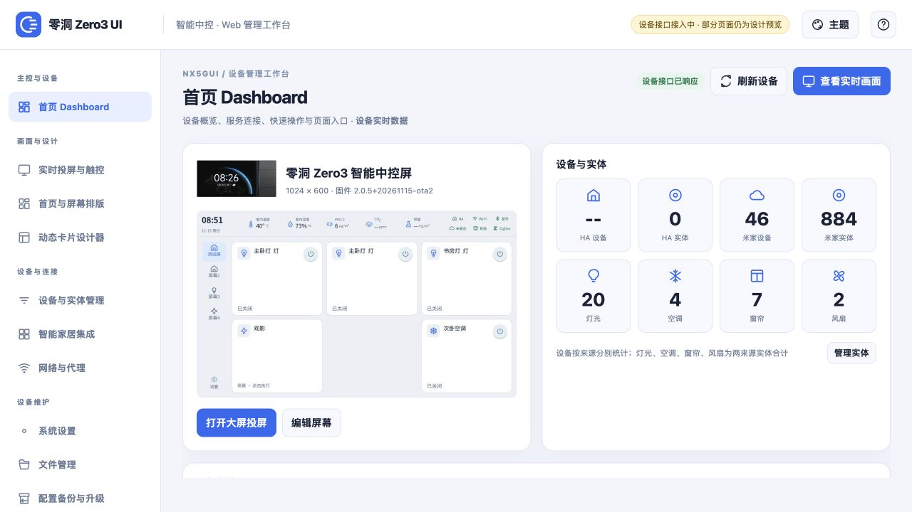
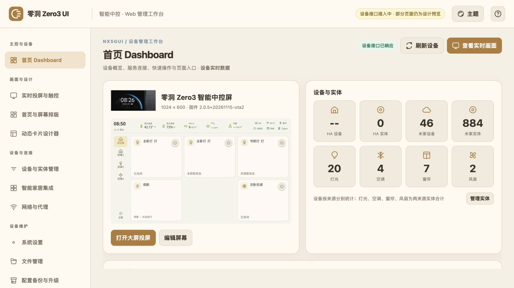

# 零洞 Zero3 UI · 固件发布仓

本仓为固件发布仓，仅维护设备安装包、升级文件、安装脚本和使用说明。源码、构建工具及开发文档在源码仓维护。

适用于 **NX5 / Zero3 · 1024 × 600 触屏面板**。基于 LVGL 9.6 与 Linux，将 Home Assistant、米家、可编排桌面、场景和 Web 管理整合到一块屏幕中，日常运行无需连接电脑。

当前正式版 **2.0.29+20261123** · 更新说明见 [本版记录](docs/releases/2.0.29.md)。

[下载正式版](https://github.com/snailll2/zero3-firmware/releases/latest) · [2.0 使用手册](USAGE.md) · [版本与升级验证](https://github.com/snailll2/zero3-firmware/blob/main/docs/releases/2.0.29.md)

## 2.0 能做什么

| 功能 | 说明 |
| --- | --- |
| 多屏桌面 | 独立屏幕名称、图标与网格，拖放卡片到指定位置；保存后应用到设备。 |
| 实体卡片 | 灯光、开关、空调、窗帘、风扇及传感器等；按实体能力显示电源、滑条、模式与详情控件。 |
| 场景执行 | 场景卡片可配置多步骤动作与延迟；也可绑定 HA 的场景、脚本或按钮实体。 |
| 四种主题 | 浅色、深色、暖色、薄荷，适配桌面、状态栏、设置与控件颜色；Web 顶部可直接预览选择。 |
| Home Assistant | 服务器与令牌配置、实体发现、状态同步及控制，设备列表可筛选并查看属性。 |
| 米家 | 小米账号授权、设备发现、MIoT 规则转换、云端与本地中枢控制；通道可用性取决于设备能力及授权。 |
| BLE / Zigbee 代理 | BLE 广播经 MQTT 转发至 HA；Zigbee 串口桥供 HA 侧 ZHA / Zigbee2MQTT 使用。 |
| 远程操作 | Web 实时投屏与触控、屏幕排版、接入与网络配置、文件管理、配置备份及黑匣子诊断。 |
| 网络与待机 | Wi-Fi 扫描和连接进度、有线网络配置、亮度、息屏、屏保与触摸唤醒。 |
| 完整升级 | 设备端更新入口、Web 在线升级及签名离线升级；显示下载、校验、安装、重启和启动检查进度。 |

卡片控件由实体实际能力决定；未同步或离线时显示对应提示。摄像头支持配置 RTSP / HA 源，兼容性与流畅度取决于视频编码和设备资源。

## 少量页面，看看实际效果

以下为 **2.0.5 实机 Web 截图**（沿用已有图）。四主题截图中嵌入的画面来自设备实时投屏；排版设计器是浏览器预览，示例读数与样式不等于设备当前状态。数量、名称与连接状态仅为拍摄现场样本。

图片以两列缩略图展示，点击可查看原图。

<table>
<tr><th>浅色</th><th>深色</th></tr>
<tr><td><a href="docs/screenshots/2.0.5/web-light.jpg"></a></td><td><a href="docs/screenshots/2.0.5/web-dark.jpg"></a></td></tr>
<tr><th>暖色</th><th>薄荷</th></tr>
<tr><td><a href="docs/screenshots/2.0.5/web-warm.jpg"></a></td><td><a href="docs/screenshots/2.0.5/web-mint.jpg"></a></td></tr>
<tr><th>屏幕排版</th><th>在线 / 离线升级</th></tr>
<tr><td><a href="docs/screenshots/2.0.5/web-layout.jpg"></a></td><td><a href="docs/screenshots/2.0.5/web-upgrade.jpg"></a></td></tr>
</table>

## 安装与升级

在 [正式发布页](https://github.com/snailll2/zero3-firmware/releases/latest) 根据用途选择文件：

| 用途 | 文件与步骤 |
| --- | --- |
| 首次安装 / 完整重新部署 | 下载 `zero3-2.0.29-full-deploy.zip`，在电脑解压，将**整个目录**传入设备，按下方命令安装。 |
| Web 离线升级 | 下载 `zero3-2.0.29.signed.tar.gz`，打开「配置备份与升级」选择文件，校验后执行升级。 |
| 在线升级 | 支持新升级引擎的设备，在 Web「配置备份与升级」中检查更新 → 下载更新 → 立即升级。 |

### Telnet 一键安装（新机 / 重新部署）

在电脑终端运行 `telnet <面板IP>`，使用该设备的管理员账户登录。部分原厂设备为 `root / 123456`，以实际设备设置为准；这类设备通常没有 SSH，不要将下面的设备命令直接粘贴到电脑终端执行。

登录面板后，只需下载安装脚本并执行，自动安装最新版本：

```sh
(
G=snailll2/zero3-firmware
for S in "ghfast.top/https://raw.githubusercontent.com/$G/main" "gh-proxy.org/https://raw.githubusercontent.com/$G/main" "cdn.jsdelivr.net/gh/$G@main" "raw.githubusercontent.com/$G/main"; do
    echo "正在尝试下载源：https://$S"
    if curl -fkL --connect-timeout 5 --max-time 30 "https://$S/installer.sh" -o /tmp/installer.sh && [ -s /tmp/installer.sh ] && sh -n /tmp/installer.sh; then
        echo '下载成功，开始执行安装脚本。'
        sh /tmp/installer.sh
        exit $?
    fi
    echo '当前源下载或校验失败，自动切换下一个下载源……'
done
echo '所有下载源均失败，请检查网络或使用离线安装。'
exit 1
)
```

脚本内部自动查找下载工具、切换代理、获取最新完整包、校验、备份、安装并重启，保留已有配置。仅校验不安装时执行 `sh /tmp/installer.sh --check`。支持自定义 GitHub 反向代理：`NX5_GITHUB_PROXY=https://proxy.example sh /tmp/installer.sh`，优先尝试指定代理，失败自动回退 ghfast、gh-proxy.org、jsDelivr 和 GitHub。初次下载脚本失败时可从仓库下载 `installer.sh` 传入设备执行。 首次下载和包内下载均支持上述四源回退。多个自定义代理按顺序填写：`NX5_GITHUB_PROXIES="https://proxy-a.example https://proxy-b.example" sh /tmp/installer.sh`；全部失败后继续尝试内置源，单代理变量仍兼容。

### 设备无法联网下载：电脑中转完整包

1. 在电脑下载完整部署 ZIP 并解压，保留 `install.sh` 与 `release/` 的目录关系。
2. 设备有文件传输工具时，将整个解压目录传到 `/data/zero3-full`。没有 SSH / scp 时，可以用下方局域网 HTTP 方法。
3. 在电脑进入解压目录，运行：

```sh
python3 -m http.server 8000 --bind 0.0.0.0
```

4. 在设备 Telnet 中执行，先把占位 IP 换成电脑的局域网地址：

```sh
(
    set -eu
    PC_IP=192.168.1.10  # 改成电脑的实际局域网 IP
    mkdir -p /data/zero3-full/release
    cd /data/zero3-full
    wget -O install.sh.part "http://$PC_IP:8000/install.sh"
    wget -O release/nx5gui_latest.tar.gz.part "http://$PC_IP:8000/release/nx5gui_latest.tar.gz"
    mv install.sh.part install.sh
    mv release/nx5gui_latest.tar.gz.part release/nx5gui_latest.tar.gz
    sh install.sh --check
    sh install.sh
    sync
    reboot
)
```

两份文件就是完整安装所需的入口和全量负载，启动脚本、规则、依赖与资源已在负载内。电脑中转目录只放公开安装包，完成后在电脑按 `Ctrl+C` 关闭临时服务。

完整部署示例，假设文件传到 `/data/zero3-full`：

```sh
cd /data/zero3-full
sh install.sh --check
sh install.sh
reboot
```

完整包包含主程序、启动脚本、显示与视频守护、运行依赖、网络工具、公共 `rules.json`、主题和卡片资源。它是应用层完整部署包，需要原厂 Linux 系统仍完整，不包含引导器、内核或分区镜像。旧版尚无新升级接口时，先用完整包迁移。

升级保留已有账户、网络、布局、场景和自定义配置。在线与离线共用完整安装流程，检查签名、型号、版本和完整性；启动检查失败时恢复上一套运行文件。升级期间保持供电，等待设备重启后的最终结果。

本版验证范围以发布说明及 RELEASE_VALIDATION.json 为准；历史实机结果不替代本版实机验收。

### 版本清单与更新文件

根目录 `version.json` 与 `release/version.json` 供版本检查使用，包含 `version`、`file`、`size`、`md5`、`sig` 和 `notes`。其中 `sig` 是签名字段，不是可省略的说明文字；文件大小、摘要和签名必须与负载配套。`release/nx5gui_latest.tar.gz` 是安装器使用的完整运行负载，`.signed.tar.gz` 是 Web 离线上传使用的签名封装，两者不能互换上传。

```json
{
  "version": "2.0.29+20261123",
  "file": "release/nx5gui_latest.tar.gz",
  "size": 10207173,
  "md5": "49816866edee887096f7cf6472ccd6db",
  "sig": "<发布时生成的 Ed25519 签名，示例占位不可用于安装>",
  "notes": [
    "Web 终端输出恢复;设计器卡片背景图上传/清除/缩略图修复;屏幕顺序调整移入屏幕属性(含说明与位置显示);页面编码与文档模式修复"
  ]
}
```

普通使用者无需修改清单，更新发布以正式包为准。旧版只核对 MD5 或通过浏览器中转无签名包的步骤不用于 2.0.6 安装。

## 第一次使用

1. 在面板「设置」中查看 Web 地址，用同一局域网的浏览器打开 `http://<设备IP>:8080/`。
2. 在「智能家居集成」配置 HA 地址和长期令牌，或完成小米账号授权。
3. 在「设备与实体管理」核对来源、类型和属性，再到「首页与屏幕排版」添加卡片、选择实体并保存。
4. 在「实时投屏与触控」核对设备的真实效果；日常也可直接在面板操作。

更详细的主题、场景、Wi-Fi、更新与排错步骤见 [使用手册](USAGE.md)。Web 配置备份不是整机镜像；授权信息和备份请留在可信环境中。

## 设备文件、授权与回原厂

| 路径 | 用途 |
| --- | --- |
| `/data/nx5gui` | 设备主程序。 |
| `/data/nx5vo` | 显示守护，负责启动 GUI，避免重复实例抢占显示。 |
| `/data/bin/start_app.sh`、`data_app.sh` | 当前开机入口和配套脚本。 |
| `/data/bin/nx5_env.sh` | 安装时生成的硬件批次环境配置。 |
| `/data/nx5_conf/intercom/` | HA、米家、布局、显示和授权等用户配置；不要公开整个目录。 |
| `/data/specs/rules.json` | 米家公共转换规则；型号 spec / 翻译缓存也在此目录。 |
| `/data/theme/theme_default/` | 主题资源。 |
| `/data/nx5nss/` | DNS / 文件名解析模块；配套运行库隔离在 `runtime/`，不要拷到系统库目录。 |
| `/data/nx5_ota/` | 升级暂存、任务结果和启动检查信息。 |
| `/data/deployment-backups/` | 安装前的运行文件备份。 |
| `/data/nx5gui_live.log`、`nx5gui_crash.log` | 运行与崩溃排查线索，具体以设备实际生成文件为准。 |

授权按设备机器码验证，在「关于」或 Web 授权区域查看状态并提交匹配的授权凭证。HA / 米家模块未授权或过期时，相关入口或接口可能受限；安装固件不等于自动获得授权，也不要复制另一台设备的授权文件。

回到原厂启动链，可在设备执行完整包内的命令：

```sh
sh /data/zero3-full/uninstall.sh
reboot
```

若只通过引导安装、目录中没有卸载脚本，可在设备上下载本版脚本后执行：

```sh
curl -fL https://raw.githubusercontent.com/snailll2/zero3-firmware/main/uninstall.sh -o /tmp/zero3-uninstall.sh && sh /tmp/zero3-uninstall.sh && reboot
```

需要设备有可用的 curl；也可用电脑下载后传入设备。当前卸载脚本仅关闭开机接管，保留账户、网络、布局、程序与备份，重启后恢复原厂启动。旧版 `PURGE=1`、`REBOOT=0` 参数不适用于此版；不要把改名整个 `/data/bin` 当成标准卸载步骤。

## 当前边界

- 动态卡片设计器为 **Beta**；天气实时数据、部分高级领域和禁用的配置项以页面提示为准。
- 本地米家控制需要可用的中枢、证书与设备授权；发现网关 IP 不代表所有米家设备都支持本地控制。
- BLE 转发不等于任意 GATT 控制；Zigbee 配网与设备管理由 HA 侧完成。
- 不承诺所有布局、摄像头或设备组合稳定达到 30 FPS；预览画布不替代真机验证。
