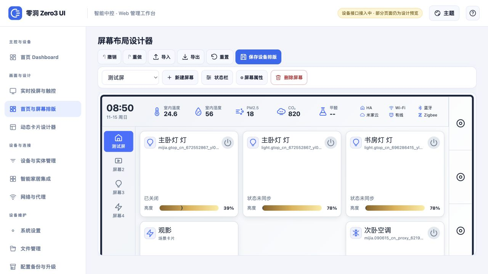
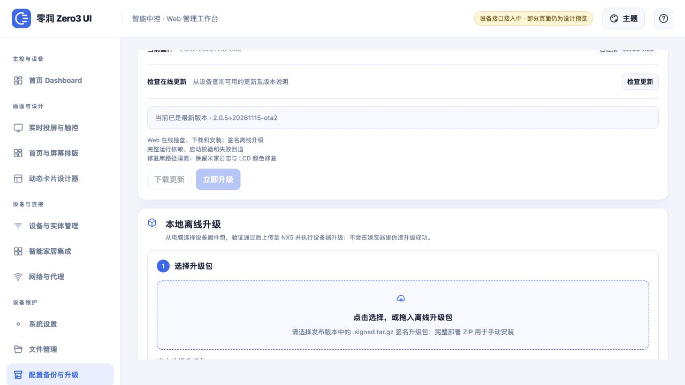

# 零洞 Zero3 UI · 2.0 使用手册

适用 **2.0 系列**，以 **2.0.7+20261115** 的使用流程为准（截图沿用 2.0.5）。更新日期：2026-11-15。

[功能与主题预览](README.md) · [下载固件](https://github.com/snailll2/zero3-firmware/releases/latest)

## 1. 连接面板

面板接通电源和网络后，进入「设置」，查看顶部 Web 管理地址。在同一局域网的电脑或手机打开 `http://<设备IP>:8080/`。不要照抄截图里的 IP。

设备屏幕用于日常控制、主题、亮度及网络设置；Web 用于输入账号、整理实体、排版、查看日志和升级。实时投屏支持远程触控，点击真实画面会发送操作到实体设备。

## 2. 接入 Home Assistant 与米家

### Home Assistant

1. 打开 Web「智能家居集成」，填写 HA 地址，例如 `http://<HA地址>:8123`。
2. 在 HA 用户个人资料的安全设置中创建长期访问令牌，粘贴到令牌框。
3. 点击「测试连接」，核对结果，再按页面保存配置。当前页面测试连接也会保存地址与令牌；令牌留空沿用已保存值。
4. 打开「设备与实体管理」，按来源筛选 HA，核对实体和属性。列表是设备本地缓存，需要重新拉取时点击「刷新实体」。

“未连接”和“实体为 0”不能直接当作令牌丢失：先核对 HA 是否在线、地址和网络是否可达，再看测试结果和日志，不要为排错直接清空配置。

### 米家

1. 在「智能家居集成」的米家卡片中点击「登录小米账号」，完成账号授权。
2. 如果授权后浏览器跳到无法打开的回调页，按页面说明复制完整回调链接或授权码，粘贴后提交；不要分享链接或授权码。
3. 点击「更新设备列表」，等待设备发现与实体生成。精简模式保留核心控制，全量模式生成更多属性实体。
4. 只有需要重新下载转换规则时，才点击「更新实体转换规则」。规则更新可能触发全量转换，不是简单刷新列表。

本地中枢通过 mDNS 发现，控制通道结合中枢能力、证书、授权和设备可达性选择。是否使用本地或云端，以设备回执和黑匣子记录为准；不能用某一家庭的设备数作为固定支持数量。

若设备列表有设备但没有实体，在黑匣子中查看 `MIJIA`：设备页数/数量、规则加载、spec 来源、转换数量、跳过原因、控制通道及耗时。完整包包含公共 `rules.json`；型号 spec 与翻译缓存仍按需获取。

### 米家按钮、生成模式与通道状态

| 操作 / 状态 | 说明 |
| --- | --- |
| 更新设备列表 | 米家 App 新增、删除或改名后重新获取设备，随后按当前模式转换实体。 |
| 更新实体转换规则 | 获取公共规则并重建实体；关注进度与日志，耗时取决于型号缓存和网络。 |
| 刷新状态 | 读取当前连接与数量，不等于重新发现所有设备。 |
| 精简（核心控制） | 生成常用控制；可用逗号分隔的附加关键词，如 `电量,模式,亮度`，保留所需属性。 |
| 全量（全部属性） | 生成更多属性实体，数量由型号能力、转换规则及设备容量决定。 |
| 本地中枢 / 米家云 | 显示当前可用通道概况；某台设备实际走哪条通道仍看该次控制日志。 |
| 未授权 / 凭据过期 / 未连接 | 分别核对授权是否完成、凭据续期以及网络 / 网关状态，不把三种情况混为一谈。 |

调整生成模式与关键词后，按页面保存并重新生成实体，核对卡片绑定是否仍有效。米家控制通道列表可用来查看本地与云端能力及设备范围；“支持本地”与某次命令已经本地执行是两个不同结果。

### 蓝牙与 Zigbee

- BLE：配置 MQTT broker，并在 HA 安装 [配套蓝牙代理集成](ha_integration/README.md)。用于广播扫描转发。
- Zigbee：启用串口桥，在 HA 侧配置 ZHA / Zigbee2MQTT。页面显示桥接运行不等于所有终端已成功配网。

### 蓝牙代理：从配置到 HA 验证

| 面板字段 | 填写方式 |
| --- | --- |
| MQTT 服务器与端口 | 填 HA 使用的 broker 地址，普通 MQTT 常用 1883，以实际服务为准。 |
| 用户名 / 密码 | broker 的认证信息；不是 HA 长期访问令牌。 |
| 启用与状态 | 保存后启用代理，检查进程、连接及转发计数。 |

HA 侧步骤：

1. 将 [配套目录](ha_integration/zero3_bt) 放到 HA 配置目录的 `custom_components/zero3_bt/`，重启 HA。
2. 确保 HA 的 MQTT 集成已连到与面板相同的 broker。
3. HA「设置 → 设备与服务 → 添加集成」搜索 Zero3 蓝牙代理并添加。
4. 核对网关在线和广播转发，再让已有的 HA 蓝牙设备集成消费广播数据。

广播主题使用 `btproxy/adv` 及带网关标识的子主题，状态通过 `btproxy/status` 上报。无广播时先看面板代理状态、MQTT 凭据、主题和 `/data/btproxy.log`，不要先删除 HA 集成。广播转发不提供任意蓝牙设备的主动连接能力。

### Zigbee 串口桥：HA 侧配置

面板启用 Zigbee 代理后，在 HA 侧使用设备提供的 TCP 串口地址。现有桥接脚本使用 8899 端口，Zigbee2MQTT 示例：

```yaml
serial:
  port: tcp://192.168.1.50:8899  # 改成面板实际 IP
  adapter: ezsp                # 按已安装 Z2M 版本及 NCP 固件选择兼容驱动
```

旧版配置使用 `ezsp`；较新的 Z2M 可能使用 `ember`，不能只改名称就认为芯片固件兼容，应按所用 Z2M 与 NCP 要求匹配。ZHA 则在添加串口协调器时填写相同 TCP 地址并选择匹配的无线协议。

连接成功后在 ZHA / Z2M 中配网、命名和管理终端。一个串口桥不要同时让 ZHA 和 Z2M 占用。BLE 与 Zigbee 共用板上无线资源，切换后分别确认两侧状态。连接失败先检查开关、端口可达性和串口占用；确需恢复芯片时再参考设备配套 `zbbridge.sh reset`，该操作会中断当前无线服务，不作为每次连接的固定步骤。

## 3. 屏幕与卡片排版

打开「首页与屏幕排版」，先选当前屏幕，再添加组件或编辑已有卡片。

1. 在工具栏新建屏幕，设置屏幕名称、图标和网格行列。
2. 添加实体卡片并选择实体，或添加场景、时钟、摄像头、命令、UDP 等组件。
3. 拖动到目标位置，按需要调整跨格尺寸。位置按网格保存，空位可以保留，无需靠前后排序填满。
4. 设置显示名称、图标与可用控制；点击「保存设备排版」。
5. 切换到「实时投屏与触控」查看真机。预览内的环境传感器示例值不代表实时读数。

<a href="docs/screenshots/2.0.5/web-layout.jpg"></a>

界面灰置的选项暂不可操作，包括当前不支持的屏幕背景图片、状态栏显示开关和长按动作。状态栏中的传感器绑定另从「状态栏」入口配置。物理按键可配置实体开关、返回首页、熄屏、唤醒和设置页，只有实体动作需要选择控制实体。

动态卡片设计器是 Beta 功能，建议先导出布局再调整。导入 / 导出布局 JSON 与配置备份是不同用途。

### 屏幕工具栏与属性逐项说明

| 项目 | 用法 |
| --- | --- |
| 当前屏幕 / 新建 / 删除 | 切换或增删页面；删除前确认该屏幕的卡片不再需要。 |
| 屏幕属性 | 设置名称、屏幕图标、网格行列等。屏幕图标用于设备侧导航，与卡片图标分开配置。 |
| 网格与卡片位置 | 按列、行和跨格尺寸安排卡片；如 3 列 × 2 行即 6 个基本格。保留空位时不会要求填满。 |
| 撤销 / 重做 | 回退或恢复本次编辑；保存前核对当前屏幕。 |
| 导入 / 导出 | 传递布局 JSON；导出后可作为修改前的布局备份。导入后仍需保存到设备。 |
| 重置 | 会影响当前编辑内容，先导出需要保留的布局。 |
| 保存设备排版 | 写入设备布局并应用；切换页面不代替保存。 |

### 实体卡片：基础属性、外观与动态控件

选中卡片后打开属性区。2.0 按三个标签组织配置：

| 标签 / 字段 | 含义与建议 |
| --- | --- |
| 基础属性 · 卡片类型 | 实体、摄像头、时钟、天气、命令或 UDP 等不同组件。 |
| 基础属性 · 设备类型 | 灯、空调、窗帘等领域；应与绑定实体一致，不能靠改变类型赋予设备不存在的能力。 |
| 基础属性 · 绑定实体 | 点击「选择设备」，按来源、类型和关键词筛选。HA 与米家中名称相同的设备可能是两个不同实体，注意 ID 与来源。 |
| 基础属性 · 显示名称 / 图标 | 设置本卡片名称与 SVG 图标；屏幕导航图标在屏幕属性中设置。 |
| 基础属性 · 预览状态 | 只辅助预览，不作为修改家电真实状态的操作。 |
| 外观 · 显示设备名称 | 控制名称是否显示。 |
| 外观 · 显示内联控制项 | 允许在卡片中显示滑条或操作按钮；小卡片可能只显示部分控件。 |
| 外观 · 点击卡片行为 | 「打开详情」进入控制弹窗；「直接控制实体」触发该实体的相应动作。 |
| 外观 · 内联控制样式 | SVG 图标按钮或文字按钮。 |
| 外观 · 状态外框 | 用边框表达状态，与编辑器的选中框不同。 |
| 外观 · 开启态 / 关闭态背景 | 分别设置两种背景色；不自定义时优先沿用主题。 |
| 外观 · 边框 / 名称颜色 | 只影响当前卡片；切换主题后也要核对可读性。 |
| 外观 · 卡片背景图片 | 选择、上传或清除卡片图片；与当前禁用的“整屏背景图片”是不同选项。 |
| 动态控件 | 查看默认领域布局或进入 Beta 设计器编辑自定义控件，保存后在实际设备验证。 |

### 组件配置与具体例子

- **灯光**：选择 `light` 实体，显示内联控制；分别验证电源、亮度以及设备支持的色温 / 颜色。未提供的能力不会因开启显示选项而增加。
- **空调**：绑定 `climate` 实体，温度范围、步长、模式和风速来自设备能力。小卡片空间不足时优先保留主要控制，打开详情查看更多；未上报温度显示缺失值，不按 0℃ 处理。
- **窗帘**：打开、停止、关闭和位置取决于实体支持情况；“关闭窗帘”不是电源关闭。
- **摄像头**：按可用配置选择 RTSP 直连或 HA 的 `camera.*` 实体。RTSP 地址形如 `rtsp://<摄像头IP>:554/<流路径>`；认证信息使用专门字段（若提供），不要公开带密码的地址。HA 摄像头实体不等于可直接取得 RTSP URL。若当前属性区没有数据源字段，先在设备已有摄像头配置入口设置，不要把“预览实时画面”当作已接入视频。
- **UDP**：填写目标 IP、1–65535 端口、文本载荷及 1–10 次重复。目标地址和动作受设备端校验，浏览器预览不发送 UDP；先用一个可控接收端确认收到的内容。
- **命令执行**：当前页面保存受控命令 ID，由设备白名单匹配与授权；不要沿用旧版“输入任意 Shell 即执行”的说明。
- **时钟 / 天气**：时钟跟随系统时间；天气实时数据尚未正式接通，预览中的天气文字不代表在线天气服务。

### 配置一条多步骤场景

例如“观影”：先添加并命名场景，再依次加入灯光关闭、延迟、窗帘关闭等动作，为每一步选择实际实体与动作参数。保存场景和屏幕排版后，在实机点击场景卡片。先单独确认每一步可用，再确认整条场景的顺序、延迟和最终状态；HA 场景 / 脚本实体也可直接绑定执行，无需重复拆解。

## 4. 日常控制与场景

| 卡片 | 操作方式 |
| --- | --- |
| 灯 / 开关 | 电源按钮控制开关；灯按能力提供亮度、色温和颜色。 |
| 空调 | 调整目标温度、运行模式和风速；按钮按实体支持的选项生成。 |
| 风扇 / 窗帘 | 风速、模式、摆头，或打开、停止、关闭、位置等实际能力。 |
| 传感器 | 只读状态、读数和单位；未同步时不应作为有效测量值使用。 |
| 场景 / 脚本 / 按钮 | 点击执行动作，不以“开 / 关”表示持续状态。 |
| 摄像头 | 配置 RTSP 或 HA 源后打开播放器，效果取决于流和硬件兼容性。 |

场景卡片可按顺序添加动作与延迟。先分别验证每个设备动作，再测试整条场景；检查实际设备状态与执行日志，不能只凭点击反馈判断成功。操作后若状态短暂滞后，等待真实状态回报，不连续快速重复下发。

## 5. 主题、状态栏与待机

Web 顶部「主题」直接打开预览选择框，可选 **浅色、深色、暖色、薄荷**；设备端也可在系统设置调整。桌面、状态栏传感器和连接图标、设置与选中控件使用对应配色。四主题实机效果见 [README 缩略图](README.md#少量页面看看实际效果)。

设备「系统设置」可调整亮度、自动息屏、屏保和锁屏样式。触摸可以唤醒；息屏不等于 Web 服务停止。状态栏只显示已绑定且已同步的数据，连接图标用于区分网络和服务状态。

## 6. Wi-Fi 与有线网络

设备上进入「设置 → Wi-Fi」，或打开 Web「网络与代理」。

1. 点击扫描，等待旋转提示结束和网络列表返回。
2. 选择网络，输入密码后点击连接；密码只在本机页面填写。
3. 等待认证和地址获取，核对最终连接状态、SSID 和 IP。扫描结束不代表连接成功。
4. 地址改变后，用面板显示的新地址重新打开 Web。

有线网络页可查看链路和地址，按需配置 DHCP 或静态参数。排错时先保留可用的有线连接，避免改 Wi-Fi 后同时失去远程入口。若扫描为空，查看无线接口和扫描错误日志；不要只重置 HA 或米家配置。

## 7. 在线升级、离线升级与完整重装

<a href="docs/screenshots/2.0.5/web-upgrade.jpg"></a>

### 在线升级

Web「配置备份与升级」：**检查更新 → 阅读版本与更新内容 → 下载更新 → 立即升级**。确认后等待下载、校验、安装、重启和启动检查完成。浏览器会等待设备重新上线并查询结果，只有最终成功才算完成。

设备端「设置 → 系统更新」也提供检查和更新入口。可开启每天定时检查；发现新版本后提示版本号和更新内容，选择立即更新、稍后更新或跳过该版本。“稍后”三天内不提示，之后在下一次检测确认新版本后再提示；跳过只针对该版本。检测开关不代表自动下载或安装。

### 离线升级

1. 从发布页下载匹配型号的 **`zero3-2.0.30.signed.tar.gz`**。
2. 在 Web 本地离线升级区域选择文件，点击「校验设备与升级包」。
3. 等待上传及设备验证；签名、型号、版本、完整性和空间满足要求后，再确认执行升级。
4. 保持供电，等待自动重启及成功结果。页面刷新后可继续查询升级任务。

不要上传完整部署 ZIP 或裸 `nx5gui_latest.tar.gz`。损坏、错型号和降级包会被拒绝；不要绕过校验。

### 完整部署 / 旧版迁移

下载 **`zero3-2.0.30-full-deploy.zip`**，在电脑解压，把整个目录传入设备，例如 `/data/zero3-full`：

```sh
cd /data/zero3-full
sh install.sh --check
sh install.sh
reboot
```

应用层完整包包括启动脚本、依赖、主题、卡片模板与公共规则，不是分区镜像。原厂系统须完整；旧版没有新 Web 升级接口时先用完整包迁移。不要混用不同版本的安装器和负载，也不要单独启动第二个 GUI。

升级和重装保留已有用户配置；首次安装使用不含家庭设备和账号的默认配置。安装备份位于 `/data/deployment-backups/`，启动检查失败时恢复上一套运行文件。当前版本的实机与隔离验证范围见对应发布说明。

回到原厂启动链使用配套 `sh uninstall.sh`，然后重启；这不是清除账户数据的恢复出厂操作。

## 8. 配置备份与诊断

Web「配置备份与升级」可导出设备当前配置 JSON，恢复时先读取、校验再提交。该导出不是全盘镜像，也不覆盖全部米家授权、规则缓存和系统网络文件；重要迁移另行备份需要保留的数据。备份可能含令牌，请私下保管。

黑匣子可查看、刷新和导出运行日志。米家日志包含设备发现、规则与转换、通道、控制回执和毫秒耗时；排错时附上时间、实体、动作、实际结果和相关日志，先去除凭据及不需要公开的标识。

| 现象 | 优先检查 |
| --- | --- |
| Web 无法打开 | 面板显示的 IP、局域网连通性与 8080 端口。 |
| 有设备但无实体 | 来源连接、规则是否加载、spec 下载与转换跳过原因。 |
| 卡片状态与实际不符 | 实体是否选对、来源与在线状态、最近状态回报及控制回执。 |
| 预览与屏幕不同 | 是否保存成功、当前屏幕、网格位置；以实时投屏核对真机。 |
| 更新按钮不可点 | 是否发现新版本、下载完成、签名校验通过或已有任务在运行。 |
| 升级后页面仍旧 | 等设备启动完成，再刷新页面，并核对实际版本和任务结果。 |

实时天气、部分高级领域及 Beta 编辑能力以当前页面和设备实际支持为准。不要把旧版截图、固定实体数量或历史性能测试作为当前设备的保证。

## 9. 对接 API 与投屏

以下示例在电脑终端执行，IP 和实体均为占位示例。只读接口用于读取设备本地实体池，不会主动替你重新发现所有设备。

### 查询实体与属性

```sh
curl -f 'http://192.168.1.50:8080/api/ha/entities?domain=climate&limit=100'
```

支持 `q` 子串、`domain` 领域和 `limit` 数量筛选。响应为实体数组，常用字段示意如下，设备实际支持的属性以返回值为准：

```json
[
  {
    "entity_id": "climate.example_ac",
    "state": "cool",
    "attributes": {
      "friendly_name": "示例空调",
      "temperature": 24,
      "current_temperature": 25,
      "hvac_modes": ["off", "cool", "heat"],
      "min_temp": 16,
      "max_temp": 30,
      "target_temp_step": 1
    },
    "domain": "climate",
    "name": "示例空调"
  }
]
```

接口沿用 HA 风格的 `entity_id / state / attributes`，并有兼容字段及可用时的 `device` 元数据；不是 HA 官方 REST 的完全等价替代。`/api/ha/entities` 同时可包含米家池，米家直连实体通常以 `mijia.` 开头。不要仅按中文名称推断来源。

### 下发控制并查询回执

下面会实际操作所填实体，先改成准备测试的设备：

```sh
curl -f 'http://192.168.1.50:8080/api/ha/control' \
  -H 'Content-Type: application/json' \
  -H 'X-NX-Request: 1' -H 'X-NX-Action: 1' \
  --data '{"entity_id":"light.example_lamp","service":"turn_on","data":{}}'
```

服务端接受命令时返回 HTTP 202 及 `request_id`，其中 `accepted:true` **不等于设备执行成功**。使用返回的 ID 查询：

```sh
curl -f 'http://192.168.1.50:8080/api/ha/control/status?request_id=123'
```

动作与参数必须匹配实体能力，错误、离线或未授权时按错误处理；回执在内存保存，重启后不能依赖旧请求 ID。相关请求标记不是身份认证凭据，接口应在可信局域网使用。

### 投屏、截图与 HA 反向实体

| 入口 | 用途 |
| --- | --- |
| Web「实时投屏与触控」 | 查看真实屏幕和发送触摸，日常优先使用页面。 |
| `GET /api/snap` | 获取单张 JPEG 截图，可直接保存为图片。 |
| `GET /api/frame?res=0` | 兼容帧接口；支持 `res=0/1/2`，无变化时可能返回协议心跳，不应将每个响应直接当 JPEG。 |
| `POST /api/touch` | 设备触摸注入接口，会操作真实界面；不是布局预览。 |

配置页列出的 `sensor.panel_screen_state` 与 `number.panel_brightness` 是面板状态 / 亮度的对接实体标识，是否在 HA 可用取决于当前接入与注册状态，先在 HA 实体清单核对后再用于自动化。投屏分辨率、码率和刷新速度受 CPU、视频播放和客户端数量影响，不沿用旧版固定带宽或帧率承诺。

## 10. 授权与更多排错

在设备「关于」或 Web 授权卡片查看机器码、模块权限与有效期。使用与该设备匹配的凭证激活；HA / 米家接口 403 时同时核对授权和请求要求，不要反复重输正确账号。

| 问题 | 进一步排查 |
| --- | --- |
| 米家新增设备未出现 | 更新设备列表，查分页数量、子设备归属、规则和 spec 转换日志。 |
| 米家控制全部失败 | 查看本地 / 云端连接、凭据续期错误和服务回执；确需重新授权时再登录，不手改到期时间绕过状态。 |
| 米家与 HA 实体数量不同 | 比较生成模式、规则版本、设备能力与过滤原因；历史“100% 对齐”是特定样本结果，不作为所有家庭保证。 |
| 温度显示 `--` | 核对是否上报、是否选对实体及属性；不要用写死数值掩盖缺失。 |
| 摄像头黑屏 | 检查 URL、认证、流编码和播放器日志；先用低负载流验证。 |
| BLE 无数据 / Zigbee 断开 | 看 MQTT、代理日志、端口及芯片占用，不同时启动重复代理。 |
| 开机后反复退出 | 保存 GUI 运行 / 崩溃日志、版本和升级任务结果，再检查资源或启动链。 |
| 没有内核持续日志 | `kmsglog.sh` 与 `bx2.sh` 默认禁用；没有对应日志文件不表示 GUI 没有启动。 |
| 在线安装下载失败 | 核对 DNS、HTTPS、剩余空间，或使用 README 的电脑中转完整安装。 |

重要路径与回原厂命令见 [README](README.md#设备文件授权与回原厂)。安装备份保留旧运行文件；Web JSON 备份覆盖范围有限，迁移前还应单独保管米家授权及所需系统网络配置。不要公开完整配置或日志中的令牌。
