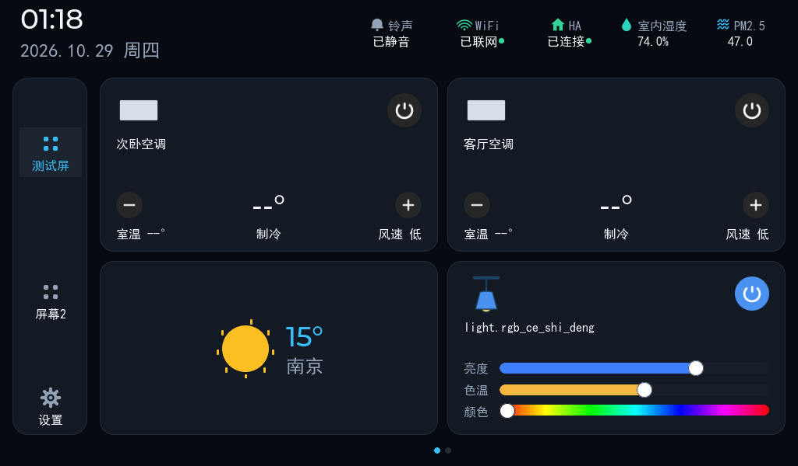
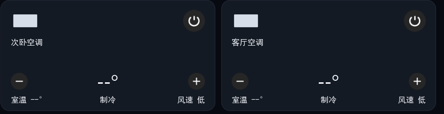
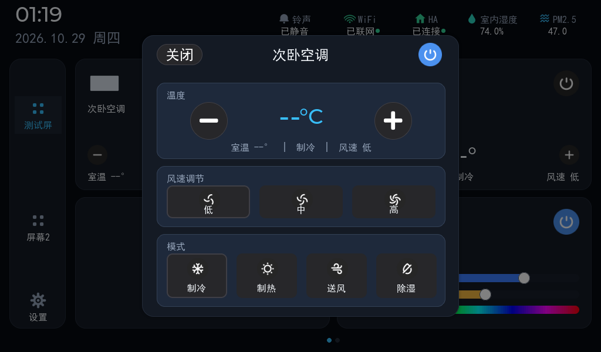

# 零洞 Zero3 面板 · 功能配置与使用说明

适用固件 1.0.186+。安装/升级见 [README.md](README.md);本文只讲装好之后怎么用、怎么配。

---

## 1. 面板端(屏幕上)

### 1.1 主页



- **侧栏**(最左列):`测试屏`/`屏幕2` 为页面切换点,底部齿轮进设置;页面多时上下拖动翻页,顶部圆点直达。
- **实体磁贴**:来自 HA 与米家的设备卡。按类型交互:
  | 类型 | 磁贴交互 | 点主体 |
  |---|---|---|
  | 开关/插座 | 右上电源钮直接开/关 | 直接开/关 |
  | 灯 | 右上电源 + 亮度/色温滑条(详细栏) | 直接开/关 |
  | **空调 (climate)** | 见 1.2 | 进详情弹窗 |
  | 窗帘 (cover) | 开/停/关三钮 | 进详情 |
  | 传感器 | 只读显示状态 | 无动作 |
  | 未配置实体 | 显示占位 | 提示「未配置实体」(不再跳页) |
- 磁贴统一**四角版式**(1.0.186):图标左上、名称左下、控制控件底部/右上;扫地机等无控件卡同样式。
- 布局、卡片、背景全部在 Web 编辑器里改(见 2.1)。

### 1.2 空调卡片(1.0.186 值表驱动)



- **大号温度居中,左右 − / + 步进 1℃**;未上报温度时显示 `--°`(不显示误导性的 0)。
- 底部信息行:**室温 | 模式 | 风速**——其中**模式和风速两段可直接点按循环切换**(制冷→制热→送风→除湿;低→中→高),点完立即回显,设备真值到达后自动校正。
- **1.0.186 起,模式与风速按设备枚举值表动态生成**:按钮数量与文案来自设备的 spec 枚举+云端中文译名(如"自动/低风/中风/高风"),不同机型自动适配;点按直发枚举值,无硬编码映射。
- 点磁贴主体进**详情弹窗**(温度 ±、风速档、模式选、右上总开关),弹窗保持打开可连续调节:



- 温度控制下发后,面板显示与空调实际值存在 VRF 总线层的短暂滞后,属设备侧特性。

### 1.3 锁屏与按键

- 锁屏三模式(设置页选择):**模拟钟表 / 数字大钟 / 相册轮播**;两级息屏(降亮→关背光),触摸唤醒。
- 物理按键(1-4 号)动作四选:**无 / 跳页面 / HA 实体 / 触发卡片**,在 Web「系统设置 → 按键」配置;绑定实体时选择器按类型过滤。

## 2. Web 管理台(浏览器开 `http://面板IP:8080`)

### 2.1 首页编辑器

- 画布拖拽摆放组件(实体/功能/时钟/天气/UDP/Shell 卡),右侧属性面板改名称、图标、两态背景色、内联操作样式(0=详细控制栏 / 1=只保留开关)。
- 屏幕管理:多屏增删、背景图(内置主题或「上传新图片」,上传落到面板本地)。
- 💾 保存即落盘生效;「恢复默认布局」一键回到出厂三卡(时钟/天气/设置)。

### 2.2 智能家居页

- **HA 连接**:填 Home Assistant 地址与长期访问令牌,「重连 HA」即时生效;连接状态实时显示。
- **米家账号(MIoT 云直连)**:
  - 「登录小米账号」跳小米 OAuth;授权后浏览器落在打不开的回调页,把**地址栏完整链接**粘回输入框「提交授权」即可。
  - **更新设备列表**:拉取米家全量设备并合并(保留已配实体,只增删)。
  - **更新实体转换规则**:按 spec 重建实体(全量模式耗时数分钟;spec 走本地缓存 /data/specs,首次需设备能访问 miot-spec.org)。
  - **生成设置**:精简(默认,仅核心控制实体+关键词命中)/ 全量(每属性一实体,池上限 4096);关键词逗号分隔,按属性描述匹配。
  - 状态行:设备数/实体数分列、控制通道(本地中枢/米家云)、凭据有效期(过期红标提示重新登录)。
  - ⚠️ 未激活授权或授权无米家模块时,本卡片自动隐藏。
- **🗂️ 设备管理弹窗**(1.0.186 新增,米家卡与 HA 卡各有一个入口):
  - 顶部**来源筛选**:全部 / 📱 米家 / 🏠 HA(米家=云直连实体 `mijia.*`;HA=经 Home Assistant 的实体);**类型筛选**:空调/灯/窗帘/开关/风扇/传感器/按钮;搜索框匹配设备名/型号/entity_id。
  - 一级为**设备列表**(设备名/型号/区域/实体数;空调行内联目标温度+室温),点设备进入其实体列表,点实体行展开 **attributes JSON**(与 HA `/api/states` 同构)。
  - 数据取**本地实体池缓存**,打开弹窗不产生网络请求;仅点「🔄 刷新」重新拉取。双侧同设备(did 相同)自动合并展示。
- **蓝牙代理 / Zigbee 代理**:网关地址、凭据、开关与运行状态(数据经 MQTT 进 HA,集成 zero3_bt)。

### 2.3 系统设置页

系统(重启/恢复)/ 网络(有线+WiFi,与面板 WiFi 设置页同源)/ 显示(亮度/息屏)/ 按键 / 关于(型号·版本·授权)。

## 3. 对接 API(`/api/ha/entities`)

面板 8080 端口暴露全量实体接口,**格式与 Home Assistant `/api/states` 同构**:

```json
{
  "entity_id": "mijia.090615_cn_proxy_621929360_00001_ktf",
  "state": "off",
  "attributes": {
    "friendly_name": "客厅空调",
    "hvac_modes": ["cool","heat","fan_only","dry","off"],
    "min_temp": 16, "max_temp": 32, "target_temp_step": 1,
    "fan_modes": ["自动","低风","中风","高风"],
    "current_temperature": 25, "temperature": 24,
    "fan_mode": "自动", "hvac_action": "off",
    "icon": "mdi:air-conditioner", "supported_features": 9
  },
  "device": { "id": "proxy.621929360.00001", "name": "客厅空调",
              "model": "090615.aircondition.ktf", "manufacturer": "090615", "area": "客厅" },
  "domain": "climate", "name": "客厅空调", "on": 0, "unit": "", "area": "客厅", "icon": ""
}
```

- `attributes` 按域供数:climate(hvac_modes/min_max_temp/fan_modes/温度)、light(亮度 0-255/色温 K)、sensor(unit/device_class)、select(options);非米家实体合成最小 attributes。
- `device` 为 HA 注册表语义的 REST 超集(HA 官方 REST 不带 device);米家实体按 did 关联,HA 侧实体按 eid 内嵌 did 关联。
- 末尾 `domain/name/on/unit/area/icon` 为兼容字段(老版选择器零改动),新对接请读 `attributes`。
- 查询参数:`?q=子串&domain=climate&limit=500`。
- 控制走 `POST /api/ha/control`(与面板磁贴同一通道)。

## 4. 授权

- 面板按机器码激活,凭证含模块位:**bit0=HA、bit1=米家**;未激活时对应功能在 Web 端整体隐藏、接口返回 403。
- 激活入口在设置页「关于」;到期后功能锁定,重新激活即恢复。

## 5. 投屏(浏览器实时画面)

- `GET /api/frame?res=0|1|2`:投屏帧(512×300 / 768×450 / **1024×600 默认**),JPEG 编码(mode3),画面无变化仅回 9 字节心跳——250ms 轮询约 100KB/s,原 raw 模式的 1/60。
- `?raw=1` 保留 raw RGBA 通道(调试用)。Web 控制台「实时监视与触控」页即此接口+触摸注入(`/api/touch`),可远程操作面板。

## 6. 升级与恢复

- **在线升级(推荐)**:设备保持通电联网,执行仓库 `bootstrap.sh` 或重跑 `install.sh` → 自动拉 `release/nx5gui_latest.tar.gz` 按 version.json 校验 md5 安装;已有配置(布局/HA/米家/授权)全部保留。
- 固件包内含全部守护脚本、主题、spec 缓存;安装脚本幂等,可重复执行。
- **恢复出厂**:`uninstall.sh`(README 有直链),或设置页系统恢复。

## 7. 常见问题

| 现象 | 处理 |
|---|---|
| Web 打不开 | 面板息屏不影响 Web;确认 8080 端口与同网段;重启面板 |
| 磁贴显示「-- 离线」 | HA/米家连接状态在智能家居页确认;米家设备启动后 ~3 分钟内完成首轮状态同步 |
| 空调温度显示 --° | 设备未上报目标温度(常见于关机态);开机设定后即显示 |
| 更新设备列表后数量变少 | 1.0.184 已修复(子设备保留+通道加长);请先升到最新版 |
| 反复重启 | 崩溃日志在面板 `/data/nx5gui_crash.log`、内核日志 `/data/kmsg.log`,反馈时附上 |
| 米家实体数与 HA 官方集成不同 | 1.0.186 已与官方 ha_xiaomi_home 1:1(实体集 100% 覆盖);个别差异为官方侧缓存滞后(如设备云改名),我们跟随云端最新值 |
| 米家控制突然全部失败(通道 none) | access_token 被云端提前吊销:米家卡重新提交一次授权链接即可;或把 `/data/nx5_conf/intercom/mijia.json` 的 `expires_ts` 改为 1 后重启面板强制刷新 |
| 投屏卡顿/带宽高 | 确认走 `/api/frame`(默认已是 JPEG);多客户端同时观看建议降低 res 档位 |
| 设备管理弹窗里 HA 实体无 device | HA 系统实体(backup/conversation 等)本无设备;设备实体按 eid 内嵌 did 自动关联 |

---

*面板端与 Web 端所有配置均落盘在面板 `/data/nx5_conf/`,升级不丢失;米家配置建议定期从 Web 导出备份(mijia.json)。*
